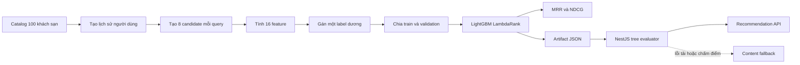

# Quy trình huấn luyện LightGBM cho Hotelia

Tài liệu này mô tả cách Hotelia tạo dữ liệu trước phát hành, huấn luyện mô hình
LightGBM LambdaRank, đánh giá kết quả, xuất model sang NestJS và kiểm tra model
trước khi triển khai.

Phiên bản được tạo ngày 23/10/2026:

- Model: `hotelia-lgbm-v2`
- Serving version: `hotelia-lgbm-2026-10-23-v2`
- Seed: `20261023`
- Catalog: 100 khách sạn
- Số query: 8.000
- Số candidate mỗi query: 8
- Train: 6.800 query
- Validation: 1.200 query
- Best iteration: 41
- LightGBM MRR@10: 0,539
- Baseline MRR@10: 0,373
- LightGBM NDCG@10: 0,650

Các metric trên được tính bằng hành vi tạo trước phát hành. Chúng xác nhận
pipeline train–export–serve hoạt động và model học được quy luật trong tập dữ
liệu. Chúng không phải bằng chứng rằng người dùng thật sẽ tăng tỷ lệ đặt phòng.

## 1. Luồng tổng thể



Script chính nằm tại
[`research/scripts/train_hotelia_lgb.py`](../research/scripts/train_hotelia_lgb.py).

## 2. Chuẩn bị môi trường

Chạy từ thư mục gốc của dự án:

```bash
cd research
python3 -m venv venv
venv/bin/python -m pip install -r requirements.txt
```

Các thư viện chính gồm LightGBM 4.7, NumPy, Polars, scikit-learn và pytest.

## 3. Đọc catalog khách sạn

Pipeline đọc hai nguồn trong repository:

- `backend/data/real-hotels.v1.json`: 20 khách sạn ban đầu.
- `backend/data/explore-hotels.v2.json`: 80 khách sạn mở rộng.

Mỗi khách sạn được chuyển thành một bản ghi có thành phố, số sao, mức giá,
điểm catalog, số lượt đánh giá và tập tiện nghi. Giá dùng khi tạo dữ liệu được
suy ra ổn định từ thành phố, hạng sao và hash tên khách sạn. Khi phục vụ thật,
backend luôn dùng giá thấp nhất từ room type đang hoạt động trong MongoDB.

Pipeline dừng ngay nếu không đọc được đúng 100 tên khách sạn duy nhất.

## 4. Tạo lịch sử hành vi

Mỗi query đại diện cho một lần người dùng nhận danh sách đề xuất. Khoảng 76%
query có lịch sử; phần còn lại dùng để model học cold start.

Một người dùng mô phỏng được gán:

- Thành phố ưa thích.
- Khoảng giá ưa thích.
- Hạng sao ưa thích.
- Một nhóm tiện nghi quan tâm.
- Từ 1 đến 12 khách sạn từng tương tác.

Khách sạn trong lịch sử được lấy theo xác suất ưu tiên những nơi phù hợp với
thành phố, mức giá, số sao và tiện nghi của persona. Mỗi signal có trọng số:

- View dùng suy giảm theo thời gian: `0.5 ^ (age_days / 14)`.
- Một booking được xác nhận có trọng số `3.0`.

Đây cũng là cơ chế backend sử dụng khi tổng hợp lịch sử 90 ngày của người dùng.
Dữ liệu tạo ra chỉ tồn tại trong bộ nhớ lúc train; script không ghi booking,
review hay recommendation event vào MongoDB.

## 5. Tạo candidate và label

Mỗi query có tám candidate:

- Tối đa bốn khách sạn cùng thành phố ưu tiên.
- Các vị trí còn lại được lấy từ phần còn lại của catalog.
- Thứ tự candidate được xáo trộn trước khi tính label.

Pipeline tính utility từ độ phù hợp thành phố, giá, sao, tiện nghi, chất lượng
và một lượng nhiễu Gumbel. Candidate có utility cao nhất nhận `label = 1`; bảy
candidate còn lại nhận `label = 0`.

Nhiễu làm cho người dùng mô phỏng không luôn chọn phương án hoàn hảo. Tuy vậy,
nhãn vẫn phản ánh chính các quy tắc tạo dữ liệu, nên không được gọi là hành vi
người dùng thật.

## 6. Bộ 16 feature

Model nhận feature theo đúng thứ tự sau:

1. `min_price_millions`: giá thấp nhất theo đơn vị triệu đồng.
2. `price_relative`: giá candidate chia giá trung bình của tám candidate.
3. `star_rating`: hạng sao.
4. `rating`: điểm đánh giá dùng cho discovery.
5. `review_log`: `log(1 + review_count)`.
6. `amenity_count`: số tiện nghi.
7. `quality_prior`: điểm chất lượng có prior năm đánh giá ở mức 3,5/5.
8. `city_affinity`: tỷ lệ trọng số lịch sử thuộc cùng thành phố.
9. `price_affinity`: độ gần giữa giá candidate và giá trung bình có trọng số.
10. `star_affinity`: độ gần giữa hạng sao candidate và lịch sử.
11. `amenity_affinity`: Jaccard tiện nghi trung bình có trọng số.
12. `history_count`: số signal lịch sử.
13. `has_history`: bằng 1 nếu có lịch sử, ngược lại bằng 0.
14. `hour_sin`: biểu diễn chu kỳ giờ bằng hàm sin.
15. `hour_cos`: biểu diễn chu kỳ giờ bằng hàm cos.
16. `is_weekend`: bằng 1 vào cuối tuần.

Danh sách và thứ tự feature được lưu trong artifact. Backend từ chối model nếu
feature contract không khớp với mã inference.

## 7. Chia dữ liệu

Pipeline giữ nguyên toàn bộ candidate của một query trong cùng một tập:

- 85% query đầu được dùng để train.
- 15% query cuối được dùng để validation.

Với cấu hình mặc định, train có 6.800 query và validation có 1.200 query. Việc
chia theo query ngăn candidate hoặc label của cùng một lần đề xuất xuất hiện ở
cả hai tập.

## 8. Cấu hình LambdaRank

Model được tạo bằng `lightgbm.LGBMRanker` với các tham số chính:

```python
lgb.LGBMRanker(
    objective="lambdarank",
    metric="ndcg",
    n_estimators=240,
    learning_rate=0.045,
    num_leaves=24,
    min_child_samples=35,
    colsample_bytree=0.9,
    subsample=0.9,
    subsample_freq=1,
    random_state=20261023,
    n_jobs=1,
)
```

Early stopping dừng khi validation không cải thiện trong 30 vòng. Lần train
hiện tại chọn iteration 41.

## 9. Cách đọc metric

MRR@10 lấy nghịch đảo vị trí của khách sạn được chọn trong tối đa 10 kết quả:

```text
rank 1 → 1,000
rank 2 → 0,500
rank 3 → 0,333
ngoài top 10 → 0
```

NDCG@10 cũng ưu tiên kết quả đúng ở vị trí cao nhưng dùng giảm logarithm.

Kết quả mới nhất:

- Baseline chất lượng: MRR@10 `0.373`, NDCG@10 `0.520`.
- LightGBM: MRR@10 `0.539`, NDCG@10 `0.650`.
- MRR@10 tăng tuyệt đối khoảng `0.166` trên validation trước phát hành.

Hit@10 bằng 1 vì mỗi query chỉ có tám candidate. Metric này chưa giúp phân biệt
model trong thí nghiệm hiện tại; MRR và NDCG có ý nghĩa hơn.

## 10. Chạy huấn luyện

Từ thư mục gốc:

```bash
cd research
venv/bin/python scripts/train_hotelia_lgb.py
```

Có thể thay số query hoặc seed:

```bash
venv/bin/python scripts/train_hotelia_lgb.py --queries 12000 --seed 20261023
```

Giữ nguyên seed và đầu vào sẽ tạo artifact có cùng checksum. Đổi seed hoặc số
query tạo ra một thí nghiệm khác và cần version mới trước khi deploy.

## 11. Artifact đầu ra

Script tạo hai file:

- Báo cáo: `research/data/models/hotelia-lgbm-v2-report.json`.
- Model đang phục vụ: `backend/src/recommendations/models/hotelia-lgbm.active.json`.

Artifact backend chứa version, thứ tự feature, các cây quyết định, báo cáo và
năm parity case. NestJS cộng leaf value của tất cả cây để tạo score cuối.

## 12. Kiểm thử sau huấn luyện

Chạy parity test, recommendation tests và build:

```bash
cd backend
npm test -- --runInBand lightgbm-ranker.spec.ts recommendations.spec.ts ranking.spec.ts
npm run build
```

Parity test dùng cùng vector feature và xác nhận TypeScript cho điểm giống
LightGBM Python đến chín chữ số thập phân. Nếu model không tải được hoặc scoring
lỗi, API tự dùng content fallback và trả `modelUsed: false`.

Sau khi deploy, kiểm tra:

```bash
curl 'https://api.hotelia.asia/api/v1/recommendations?sessionId=<UUID>&limit=5'
```

Response đúng phải có:

```json
{
  "ranking": {
    "mode": "lightgbm-discovery",
    "version": "hotelia-lgbm-2026-10-23-v2",
    "modelUsed": true
  }
}
```

Sau khi ghi một view hợp lệ cho cùng session, `mode` phải đổi thành
`lightgbm-personalized` và `signalCount` phải lớn hơn 0.

## 13. Chuyển sang dữ liệu thật

Khi ứng dụng có người dùng, thay phần sinh label bằng pipeline từ:

1. Recommendation impression đã được server ghi nhận.
2. Detail open gắn đúng impression và candidate.
3. Hold phòng hoặc booking xác nhận.
4. Loại booking hủy, hết hạn hoặc hoàn tiền theo mục tiêu thí nghiệm.
5. Tạo label theo một thang relevance, ví dụ open = 1, hold = 2, confirmed = 3.
6. Chia train/validation theo thời gian và theo session.
7. So sánh với content fallback trước khi bật cho toàn bộ traffic.

Nên giữ model trước phát hành làm baseline kỹ thuật. Chỉ gọi model mới tốt hơn
cho người dùng khi A/B test cho thấy cải thiện trên conversion, MRR/NDCG từ hành
vi thật và không làm tăng hủy phòng hoặc thời gian phản hồi.

## 14. Nội dung có thể chứng minh khi thuyết trình

Có thể chứng minh:

- Pipeline có thể tái tạo bằng một câu lệnh.
- Train và validation được tách theo query.
- LightGBM vượt baseline trên validation trước phát hành.
- Python và TypeScript cho cùng score.
- API có fallback khi model lỗi.
- Hai lịch sử khác nhau tạo thứ tự đề xuất khác nhau.

Không nên tuyên bố rằng MRR hiện tại phản ánh người dùng thật hoặc model đã làm
tăng doanh thu. Bằng chứng đó chỉ có sau khi thu thập outcome thật và chạy A/B
test trên production.
