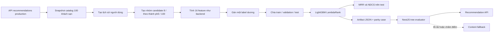

# Quy trình huấn luyện LightGBM cho Hotelia

Tài liệu này mô tả cách Hotelia tạo dữ liệu trước phát hành, huấn luyện mô hình
LightGBM LambdaRank, đánh giá kết quả, xuất model sang NestJS và kiểm tra model
trước khi triển khai.

Phiên bản được tạo ngày 24/10/2026:

- Model: `hotelia-lgbm-v3`
- Serving version: `hotelia-lgbm-2026-10-24-v3`
- Seed: `20261024`
- Catalog: snapshot 100 khách sạn từ API production
  (`research/data/hotelia-catalog-snapshot.json`, SHA-256 `3070e53c…`)
- Số query: 20.000 (train 14.000, validation 3.000, test 3.000)
- Best iteration: 10
- Kết quả trên tập test (3.000 query):

| Phương pháp | MRR@10 | NDCG@10 | Hit@10 |
|---|---|---|---|
| Baseline `quality_prior` | 0,286 | 0,405 | 0,796 |
| Content fallback (`ranking.ts`) | 0,416 | 0,526 | 0,879 |
| LightGBM v3 | 0,415 | 0,524 | 0,871 |
| Oracle (utility kỳ vọng, không nhiễu) | 0,424 | 0,534 | 0,884 |

Các metric trên được tính bằng hành vi tạo trước phát hành. LightGBM học gần tới
giới hạn trên của tập dữ liệu (oracle), nhưng không vượt content fallback, vì
utility sinh nhãn dùng gần cùng các tín hiệu mà content fallback đã mã hóa.
Kết quả xác nhận pipeline train–export–serve, không chứng minh model tốt hơn
fallback hay làm tăng tỷ lệ đặt phòng của người dùng thật.

## 1. Thay đổi so với v1 và v2

| | v1 | v2 | v3 |
|---|---|---|---|
| Thuộc tính khách sạn | Sinh bằng hash | Sinh bằng hash | Snapshot từ API đang phục vụ |
| Lịch sử người dùng | Persona cố định | Signal có trọng số như backend | Như v2, tối đa 50 signal, 90 ngày |
| Candidate mỗi query | 8 | 8 | 8, toàn bộ một thành phố, hoặc toàn catalog 100 |
| Tập báo cáo metric | Validation dùng early stopping | Như v1 | Tập test tách riêng |
| Baseline so sánh | `quality_prior` | `quality_prior` | Thêm content fallback và oracle |
| Giờ trong feature | Giờ server | Giờ server | Giờ Việt Nam (UTC+7) |
| Parity test | Score 5 vector | Score 5 vector | Score + từng feature của 16 feature |

Số liệu lịch sử: v1 MRR@10 0,620 / NDCG@10 0,713 (best iteration 7); v2 MRR@10
0,539 / NDCG@10 0,650 (best iteration 41). Hai bản này báo cáo trên tập validation
dùng cho early stopping, chỉ so với baseline chất lượng và có candidate cố định 8,
nên không so sánh trực tiếp được với v3.

## 2. Luồng tổng thể



## 3. Snapshot catalog

```bash
cd research
venv/bin/python scripts/export_hotelia_catalog.py
```

Script gọi `GET /api/v1/recommendations?limit=100` (chỉ đọc) và lưu giá thấp nhất
của room type đang bán, hạng sao, tiện nghi, thành phố, rating và số review theo
đúng quy tắc của `RecommendationsService.recommend`: review đã xác minh nếu có,
nếu không thì dùng giá trị biên tập, nếu không có nữa thì bằng 0. Snapshot có
checksum SHA-256 và được commit để mỗi lần train tái lập được.

Khi catalog production thay đổi (giá, khách sạn mới), cần xuất snapshot mới,
train lại và tăng version.

## 4. Tạo lịch sử hành vi

Khoảng 76% query có lịch sử. Số signal lấy từ 1–12 (70%) hoặc 13–50 (30%), khớp
giới hạn `history_count ≤ 50` của backend. Khách sạn trong lịch sử được chọn theo
xác suất ưu tiên thành phố, giá, sao và tiện nghi của một persona. Trọng số:

- View: `0.5 ^ (age_days / 14)`, tuổi tối đa 90 ngày.
- Booking xác nhận: `3.0` (18% signal).

Dữ liệu tạo ra chỉ tồn tại trong bộ nhớ; script không ghi vào MongoDB.

## 5. Candidate và label

Backend chấm điểm mọi khách sạn còn lại sau bộ lọc, nên nhóm candidate có ba dạng:

- `sample_8` (45%): 4 khách sạn cùng thành phố ưa thích + 4 khách sạn khác.
- `destination` (35%): toàn bộ khách sạn của một thành phố, trung bình 8,8.
- `full_catalog` (20%): cả 100 khách sạn, tương ứng truy vấn không chọn điểm đến.

Utility kỳ vọng là tổ hợp tuyến tính của `city_affinity`, `price_affinity`,
`star_affinity`, `amenity_affinity`, `quality_prior` và `price_relative`, cộng
thưởng nhỏ cho tiện nghi gia đình vào cuối tuần. Cộng nhiễu Gumbel rồi lấy
argmax tương đương lựa chọn softmax; candidate được chọn có `label = 1`.

## 6. Bộ 16 feature

Thứ tự feature và công thức nằm trong `lightgbm-ranker.ts` (`candidateFeatures`)
và được port sang Python (`candidate_features`):

1. `min_price_millions` 2. `price_relative` 3. `star_rating` 4. `rating`
5. `review_log` 6. `amenity_count` 7. `quality_prior` 8. `city_affinity`
9. `price_affinity` 10. `star_affinity` 11. `amenity_affinity`
12. `history_count` (tối đa 50) 13. `has_history` 14. `hour_sin` 15. `hour_cos`
16. `is_weekend`

Tên thành phố và tiện nghi được chuẩn hóa giống backend (bỏ dấu, `đ → d`, chữ
thường, bỏ ký tự không phải chữ số), nên `Pool` và `pool` là cùng một tiện nghi.
Giờ và ngày cuối tuần được tính theo giờ Việt Nam (UTC+7), không phụ thuộc múi
giờ của server.

## 7. Chia dữ liệu và cấu hình

Chia theo query: 70% train, 15% validation (chỉ dùng cho early stopping), 15% test
(chỉ dùng để báo cáo).

```python
lgb.LGBMRanker(
    objective="lambdarank", metric="ndcg", n_estimators=1000,
    learning_rate=0.05, num_leaves=31, min_child_samples=50,
    colsample_bytree=0.9, subsample=0.9, subsample_freq=1,
    random_state=20261024, n_jobs=1,
)
```

Early stopping theo NDCG@10 trên validation, dừng sau 50 vòng không cải thiện.

## 8. Kết quả theo loại nhóm candidate (tập test)

| Nhóm | Số query | Candidate TB | Quality | Content | LightGBM | Oracle |
|---|---|---|---|---|---|---|
| `sample_8` | 1.311 | 8 | 0,335 | 0,519 | 0,529 | 0,537 |
| `destination` | 1.106 | 8,8 | 0,363 | 0,414 | 0,407 | 0,414 |
| `full_catalog` | 583 | 100 | 0,029 | 0,190 | 0,176 | 0,191 |

(Giá trị là MRR@10.) Với 8 candidate Hit@10 luôn bằng 1 nên không dùng để so sánh;
với 100 candidate, Hit@10 có ý nghĩa: quality 0,084, content 0,458, LightGBM 0,419.

## 9. Chạy huấn luyện và artifact

```bash
cd research
venv/bin/python scripts/train_hotelia_lgb.py
```

Script tạo `research/data/models/hotelia-lgbm-v3-report.json` và
`backend/src/recommendations/models/hotelia-lgbm.active.json`. Artifact chứa
version, thứ tự feature, cây quyết định, báo cáo, 5 parity case điểm số và 2 kịch
bản parity feature (có lịch sử lúc 20:30 thứ Sáu giờ Việt Nam, và cold start lúc
01:00 thứ Bảy giờ Việt Nam nhưng vẫn là thứ Sáu theo UTC).

## 10. Kiểm thử sau huấn luyện

```bash
cd backend
npm test -- --runInBand lightgbm-ranker.spec.ts recommendations.spec.ts ranking.spec.ts
npm run build
cd ../research
venv/bin/python -m pytest tests -q
```

- Parity điểm số: TypeScript cho cùng score với LightGBM Python đến 9 chữ số thập phân.
- Parity feature: backend tính lại 16 feature cho từng candidate trong kịch bản cố định và so khớp đến 9 chữ số.
- Múi giờ: kết quả giống nhau khi chạy test với `TZ=UTC` và `TZ=America/Los_Angeles`.

Sau khi deploy:

```bash
curl 'https://api.hotelia.asia/api/v1/recommendations?sessionId=<UUID>&limit=5'
```

Response phải có `"version": "hotelia-lgbm-2026-10-24-v3"` và `"modelUsed": true`.

## 11. Chuyển sang dữ liệu thật

Khi có người dùng, thay phần sinh label bằng impression, detail-open, hold và
booking xác nhận do server ghi nhận; chia train/test theo thời gian và session;
so sánh với content fallback bằng A/B test trước khi bật cho toàn bộ traffic.

Không tuyên bố rằng MRR hiện tại phản ánh người dùng thật hoặc model đã làm tăng
doanh thu. Với dữ liệu sinh hiện tại, LightGBM chỉ ngang content fallback.
